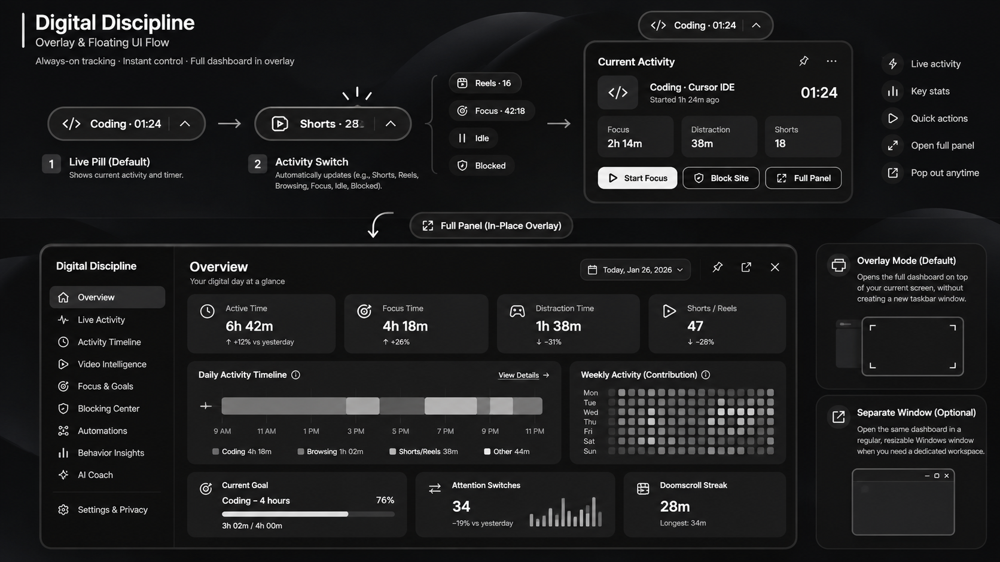
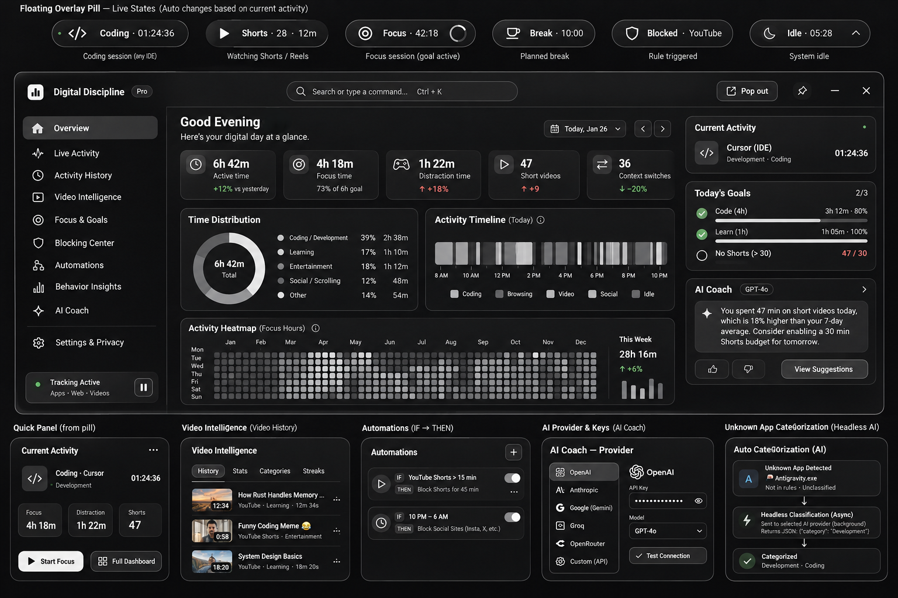

# Digital Discipline — Windows-first product blueprint

**Status:** Specification and visual design only. **No application code is included.**

**Working name:** Digital Discipline (not final brand)  
**Revision:** 0.1 • 2026-11-03  
**Primary platform:** Windows 10/11 (Windows 11 primary test target)  
**First browser:** Brave, with Chrome/Edge adapters next  
**Design:** monochrome / charcoal, black-white YouTube-controls inspiration, overlay-first  
**Architecture:** Rust background agent + Tauri v2 desktop UI + React/TypeScript + Chromium Manifest V3 extension + SQLite, with optional BYOK AI.

## Read this first

The user selected **all 32 features A1–A8, B1–B8, C1–C8, D1–D8**. Every feature is documented and has a release target. The user wants:

1. A silent, low-overhead Windows activity and productivity tracker that does **not** require the GUI to stay open.
2. Universally categorized software activity, including **any IDE** (Cursor, Antigravity, VS Code, JetBrains, Neovim, terminals, future/unknown IDEs)—never a VS Code-only heuristic.
3. Detailed web/video behavior (YouTube Shorts, Instagram Reels, browser tabs, watch counts, durations and categories).
4. Time limits, partial-site blocking, configurable strict sessions, automation rules and schedules.
5. A tiny dynamic floating pill that expands to quick panel and then full **in-place overlay**; a normal standalone window is optional.
6. A visually rich dashboard with a GitHub-like calendar heatmap, activity timeline, behavioral flows and data drill-downs—not simply generic charts.
7. Asynchronous categorization of unknown applications: continue tracking while a separate queue optionally researches and sends **structured JSON** to a local/remote AI, then backfills classification. No guaranteed-unlimited cloud service assumed.
8. An optional **AI Coach with provider picker and BYOK** (OpenAI, Anthropic, Google Gemini, Groq, OpenRouter, local Ollama, configurable API-compatible endpoint), with keys protected in Windows credential storage.
9. Local-first and privacy-first processing with clearly disclosed permissions and safe recovery from blocking failures.
10. **Do not start coding until the user explicitly approves implementation.** This package exists to hand to designers, engineers, or AI coding agents later.

## Folder map

```text
Digital-Discipline-Blueprint/
├── README.md                                  You are here
├── AGENTS.md                                  Instructions for a future coding agent
├── docs/
│   ├── 00-Executive-Spec.md                   Product identity, goals, non-goals, success metrics
│   ├── 01-Feature-Matrix.md                   Every one of the 32 selected features
│   ├── 02-UX-Journeys-and-Navigation.md       Key user journeys, IA and GUI behavior
│   ├── 03-Visual-Design-and-Overlay.md        Styling, pill states, layouts, wireframe specs
│   ├── 04-Architecture-and-Tech-Stack.md      Components, languages, IPC and lifecycles
│   ├── 05-Windows-Tracking-Engine.md          Process identification, time reconciliation
│   ├── 06-Browser-and-Video-Tracking.md       MV3 extension and short-video accounting
│   ├── 07-Data-Model-and-Analytics.md         Logical schema, aggregation, retention
│   ├── 08-Async-App-Categorization.md         Rule/cache/research/AI fallback pipeline
│   ├── 09-Blocking-and-Automations.md         Rule grammar, priority, blocking safety
│   ├── 10-AI-Coach-BYOK.md                    Provider adapters, settings, data boundaries
│   ├── 11-Privacy-Security-and-Threats.md     Threat model and risk controls
│   ├── 12-Performance-Reliability-Tests.md    Budgets, failure tests, validation matrix
│   ├── 13-Roadmap-and-Definition-of-Done.md   Milestones, acceptance and handoffs
│   ├── 14-Open-Decisions-and-Risks.md         Explicit assumptions and pending decisions
│   ├── 15-Research-Sources.md                 Primary documentation and validation notes
│   ├── 16-Screen-by-Screen-Spec.md            Detailed interface inventory
│   ├── 17-Build-Execution-Guide.md           Future step-by-step build guide
│   └── 18-Contracts-and-State-Machines.md    Event protocols and process states
├── schemas/
│   ├── classification-contract.example.json  Illustrative structured data, NOT application code
│   └── automation-rule.example.json          Illustrative automation contract, NOT application code
├── checklists/
│   ├── MVP-Acceptance-Checklist.md
│   └── Privacy-and-Release-Checklist.md
└── reference-images/
    ├── overlay-flow-concept.png
    ├── dashboard-and-ai-concept.png
    └── user-reference-*.png                  Images supplied by the user
```

## Implementation sequence

**Proof of feasibility → tracking accuracy → extension reliability → foundational blocker → overlay/dashboard → categorization → deeper automation and behavioral intelligence → optional AI/sync.** See `docs/13-Roadmap-and-Definition-of-Done.md` for phase gates and explicit acceptance tests.

## Product policies

- The user's goals define what is distracting. Never label an activity objectively “wasted” by its domain alone.
- Distinguish **foreground, active, idle, playback, focus, distracting and unclassified** time; report coverage and uncertainty.
- Browser extensions cannot see every browser/profile automatically. Only installed/enabled supported browsers are included.
- A single URL visit does not prove a video view. Qualified plays and unique/repeated views are different metrics.
- A normal user can disable their own extension or uninstall an app. Do not promise unbypassable restrictions.
- Automatic external data transmission is **off by default**. Metadata lookups and BYOK AI are opt-in; no unsolicited screenshots, microphone, clipboard or key logging.
- The application must survive offline mode, API failures, service-worker suspension, Windows sleep and GUI closure.
- No cloud or AI component may block the real-time tracking, timer or policy pipelines.
- All research and proposed library APIs should be reverified at implementation time; documentation is the baseline design, not a compatibility guarantee.

## UI references





These concept images contain **illustrative metrics, placeholder labels and unimplemented controls**. Their visuals are directional, not pixel-perfect acceptance requirements. The final design should be approved by the user before implementation.
